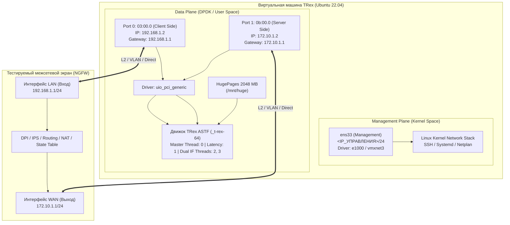

# Развертывание генератора трафика Cisco TRex (v3.08) на Ubuntu 22.04 LTS (CLI / без Web)

> **Назначение:** Пошаговое инженерное руководство по установке, низкоуровневой настройке DPDK/Hugepages, конфигурированию сетевых портов и запуску Cisco TRex в режиме ASTF (Advanced Stateful Traffic Generator) на чистой ОС Ubuntu 22.04 без графической оболочки и веб-панелей.  
> **Окружение стенда:** Виртуальная машина VMware ESXi / Workstation, 4 vCPU, 8 ГБ RAM, 3 сетевых интерфейса VMXNET3/e1000.  
> **Дата разработки:** Октябрь 2026 г.

---

## 📑 Содержание
1. [Архитектура и системные требования](#1-архитектура-и-системные-требования)
2. [Подготовка операционной системы Ubuntu 22.04](#2-подготовка-операционной-системы-ubuntu-2204)
3. [Настройка памяти Hugepages и ядра Linux](#3-настройка-памяти-hugepages-и-ядра-linux)
4. [Установка дистрибутива Cisco TRex v3.08](#4-установка-дистрибутива-cisco-trex-v308)
5. [Идентификация сетевых интерфейсов и привязка к DPDK](#5-идентификация-сетевых-интерфейсов-и-привязка-к-dpdk)
6. [Создание конфигурационного файла /etc/trex_cfg.yaml](#6-создание-конфигурационного-файла-etctrex_cfgyaml)
7. [Настройка скрипта запуска и службы systemd](#7-настройка-скрипта-запуска-и-службы-systemd)
8. [Управление и мониторинг через интерактивную консоль TRex](#8-управление-и-мониторинг-через-интерактивную-консоль-trex)
9. [Отладка и валидация профилей нагрузки (astf-sim)](#9-отладка-и-валидация-профилей-нагрузки-astf-sim)
10. [Диагностика типичных неисправностей (Troubleshooting)](#10-диагностика-типичных-неисправностей-troubleshooting)

---

## 1. Архитектура и системные требования

Cisco TRex — это высокопроизводительный генератор сетевого трафика на базе **DPDK (Data Plane Development Kit)**, работающий напрямую с кольцевыми буферами сетевых карт в пространстве пользователя (User Space), минуя стек сетевой подсистемы ядра Linux.



### 1.1. Аппаратные ресурсы ВМ
* **vCPU:** 4 ядра (рекомендуется Intel Xeon Gold / Core i7 с поддержкой инструкций SSE 4.2 / AVX2). В свойствах ВМ включить опцию `Expose hardware assisted virtualization to the guest OS`.
* **RAM:** 8 ГБ (2 ГБ выделяется под HugePages DPDK, остальное — под стек ОС и кэш).
* **Диск:** от 40 ГБ (SSD/NVMe).
* **Сетевые адаптеры:**
  1. `NIC 1` (Management): тип `e1000` или `VMXNET3`, сеть управления (например, 192.168.10.0/24).
  2. `NIC 2` (TRex Port 0 - Client): тип `VMXNET3`, порт подключения к LAN/Ingress интерфейсу NGFW.
  3. `NIC 3` (TRex Port 1 - Server): тип `VMXNET3`, порт подключения к WAN/Egress интерфейсу NGFW.
* **Требование к vSwitch/PortGroup в VMware:**
  * `Promiscuous mode`: **Accept**
  * `MAC address changes`: **Accept**
  * `Forged transmits`: **Accept**

---

## 2. Подготовка операционной системы Ubuntu 22.04

Выполните обновление пакетной базы и установку системных утилит компиляции, трассировки и DPDK-зависимостей:

```bash
sudo apt-get update && sudo apt-get upgrade -y
sudo apt-get install -y \
    build-essential \
    linux-headers-$(uname -r) \
    pciutils \
    ethtool \
    net-tools \
    python3 \
    python3-pip \
    python3-distutils \
    zlib1g-dev \
    libibverbs-dev \
    libelf-dev \
    libnuma-dev \
    strace \
    tcpdump \
    htop \
    curl \
    wget
```

Отключите управление тестовыми сетевыми интерфейсами в NetworkManager и Netplan, чтобы ядро Linux не пыталось запрашивать для них DHCP или назначать IPv6-адреса:

```bash
# Проверка сетевых интерфейсов
ip -br link

# Исключение тестовых интерфейсов (ens160, ens192) из NetworkManager
sudo tee /etc/NetworkManager/conf.d/99-trex-unmanaged.conf << 'EOF'
[keyfile]
unmanaged-devices=interface-name:ens160;interface-name:ens192;interface-name:enp*
EOF

sudo systemctl restart NetworkManager
```

---

## 3. Настройка памяти Hugepages и ядра Linux

DPDK требует непрерывные блоки физической памяти огромного размера (Hugepages по 2 МБ или 1 ГБ) для устранения промахов в TLB (Translation Lookaside Buffer) процессора при передаче миллионов пакетов в секунду.

### 3.1. Выделение 1024 страниц по 2 МБ (2048 МБ)
Выполните выделение страниц и создание точки монтирования:

```bash
# Выделение страниц на лету
sudo sysctl -w vm.nr_hugepages=1024

# Создание и монтирование hugetlbfs
sudo mkdir -p /mnt/huge
sudo mount -t hugetlbfs nodev /mnt/huge
```

### 3.2. Персистентное сохранение Hugepages в sysctl и fstab

```bash
# Добавление в /etc/sysctl.d/99-trex.conf
sudo tee /etc/sysctl.d/99-trex.conf << 'EOF'
vm.nr_hugepages=1024
EOF

# Добавление точки монтирования в /etc/fstab
if ! grep -q "/mnt/huge" /etc/fstab; then
    echo "nodev /mnt/huge hugetlbfs defaults 0 0" | sudo tee -a /etc/fstab
fi
```

Проверка состояния памяти:
```bash
grep -i huge /proc/meminfo
# Ожидаемый вывод:
# HugePages_Total:    1024
# HugePages_Free:     1024
# Hugepagesize:       2048 kB
```

---

## 4. Установка дистрибутива Cisco TRex v3.08

Установка производится в каталог `/opt/trex`.

```bash
# Создание директории
sudo mkdir -p /opt/trex
cd /opt/trex

# Загрузка актуального релиза v3.08
sudo wget --no-check-certificate https://trex-tgn.cisco.com/trex/release/v3.08.tar.gz

# Распаковка архива
sudo tar -xzf v3.08.tar.gz
sudo rm -f v3.08.tar.gz

# Проверка содержимого
ls -la /opt/trex/v3.08
```

В каталоге `/opt/trex/v3.08` находятся ключевые исполняемые бинарные файлы:
* `t-rex-64` — скрипт-оболочка запуска генератора.
* `_t-rex-64` — скомпилированный бинарный C++/DPDK-движок.
* `trex-console` — Python CLI консоль управления и сбора метрик в реальном времени.
* `dpdk_nic_bind.py` — утилита переключения драйверов сетевых интерфейсов.
* `dpdk_setup_ports.py` — интерактивный мастер генерации конфигурации `/etc/trex_cfg.yaml`.
* `astf/` — библиотека эталонных сценариев прикладной нагрузки L7 (HTTP, HTTPS, SFR, EMIX, DNS, SIP, IMAP).

---

## 5. Идентификация сетевых интерфейсов и привязка к DPDK

Для работы DPDK с виртуальными интерфейсами VMware VMXNET3 в Ubuntu 22.04 используется стандартный драйвер пространства пользователя `uio_pci_generic`.

### 5.1. Загрузка модулей ядра Linux
```bash
sudo modprobe uio
sudo modprobe uio_pci_generic

# Автозагрузка модулей при старте ОС:
sudo tee /etc/modules-load.d/trex-uio.conf << 'EOF'
uio
uio_pci_generic
EOF
```

### 5.2. Определение PCI-адресов сетевых карт
Выполните команду вывода статуса сетевых адаптеров:
```bash
cd /opt/trex/v3.08
sudo python3 dpdk_nic_bind.py --status
```

Пример вывода:
```text
Network devices using kernel driver
===================================
0000:02:01.0 '82545EM Gigabit Ethernet Controller (Copper)' if=ens33 drv=e1000 unused=uio_pci_generic *Active*
0000:03:00.0 'VMXNET3 Ethernet Controller' if=ens160 drv=vmxnet3 unused=uio_pci_generic
0000:0b:00.0 'VMXNET3 Ethernet Controller' if=ens192 drv=vmxnet3 unused=uio_pci_generic
```

В нашем случае:
* `02:01.0` (`ens33`) — оставляем под управлением ядра для SSH/Management.
* `03:00.0` (`ens160`) — Port 0 TRex (Клиент).
* `0b:00.0` (`ens192`) — Port 1 TRex (Сервер).

### 5.3. Переключение адаптеров на драйвер uio_pci_generic
Перед привязкой интерфейсы необходимо отключить в ядре:
```bash
sudo ip link set ens160 down 2>/dev/null || true
sudo ip link set ens192 down 2>/dev/null || true

# Привязка к DPDK
sudo python3 dpdk_nic_bind.py --bind=uio_pci_generic 03:00.0 0b:00.0

# Проверка привязки
sudo python3 dpdk_nic_bind.py --status
```

Ожидаемый статус:
```text
Network devices using DPDK-compatible driver
============================================
0000:03:00.0 'VMXNET3 Ethernet Controller' drv=uio_pci_generic unused=vmxnet3
0000:0b:00.0 'VMXNET3 Ethernet Controller' drv=uio_pci_generic unused=vmxnet3
```

---

## 6. Создание конфигурационного файла /etc/trex_cfg.yaml

Конфигурация TRex задаётся в формате YAML в файле `/etc/trex_cfg.yaml`.

```bash
sudo tee /etc/trex_cfg.yaml << 'EOF'
- version: 2
  interfaces: ['03:00.0', '0b:00.0']
  port_info:
      - ip: 192.168.1.2
        default_gw: 192.168.1.1
      - ip: 172.10.1.2
        default_gw: 172.10.1.1

  platform:
      master_thread_id: 0
      latency_thread_id: 1
      dual_if:
        - socket: 0
          threads: [2, 3]
EOF
```

### Разбор директив конфигурации:
| Параметр | Значение | Пояснение |
|---|---|---|
| `version` | `2` | Формат схемы конфигурации TRex v2. |
| `interfaces` | `['03:00.0', '0b:00.0']` | Список PCI-адресов портов (Port 0 и Port 1). |
| `port_info[0].ip` | `192.168.1.2` | IP-адрес Port 0 TRex (сторона эмуляции клиентов). |
| `port_info[0].default_gw` | `192.168.1.1` | Шлюз для Port 0 (LAN-интерфейс тестируемого NGFW). |
| `port_info[1].ip` | `172.10.1.2` | IP-адрес Port 1 TRex (сторона эмуляции серверов). |
| `port_info[1].default_gw` | `172.10.1.1` | Шлюз для Port 1 (WAN-интерфейс тестируемого NGFW). |
| `master_thread_id` | `0` | Ядро CPU #0 выделяется под оркестрацию и RPC API. |
| `latency_thread_id` | `1` | Ядро CPU #1 выделяется под измерение джиттера и задержек L4–L7. |
| `threads` | `[2, 3]` | Ядра CPU #2 и #3 используются как DPDK RX/TX worker-потоки передачи трафика. |

---

## 7. Настройка скрипта запуска и службы systemd

Для непрерывной автономной работы TRex в фоновом режиме на сервере создаётся системный скрипт инициализации и юнит systemd.

### 7.1. Скрипт подготовки и запуска `/opt/trex/start_trex_engine.sh`
```bash
sudo tee /opt/trex/start_trex_engine.sh << 'EOF'
#!/bin/bash
set -e

# 1. Отключаем обработку интерфейсов в стеке ядра
ip addr flush dev ens160 2>/dev/null || true
ip link set ens160 down 2>/dev/null || true
ip addr flush dev ens192 2>/dev/null || true
ip link set ens192 down 2>/dev/null || true

# 2. Обеспечиваем выделение Hugepages
sysctl -w vm.nr_hugepages=1024
mkdir -p /mnt/huge
mountpoint -q /mnt/huge || mount -t hugetlbfs nodev /mnt/huge

# 3. Привязываем адаптеры к uio_pci_generic (если слетели при перезагрузке)
cd /opt/trex/v3.08
./dpdk_nic_bind.py --bind=uio_pci_generic 03:00.0 0b:00.0 2>/dev/null || true

# 4. Запускаем TRex в режиме ASTF с удержанием stdin
tail -f /dev/null | ./t-rex-64 -i --astf
EOF

sudo chmod +x /opt/trex/start_trex_engine.sh
```

### 7.2. Создание systemd-сервиса `trex-engine.service`
```bash
sudo tee /etc/systemd/system/trex-engine.service << 'EOF'
[Unit]
Description=Cisco TRex Traffic Generator Engine (ASTF)
After=network.target

[Service]
Type=simple
User=root
WorkingDirectory=/opt/trex/v3.08
ExecStart=/opt/trex/start_trex_engine.sh
Restart=on-failure
RestartSec=5
LimitMEMLOCK=infinity
LimitNOFILE=65535

[Install]
WantedBy=multi-user.target
EOF

# Активация и запуск службы
sudo systemctl daemon-reload
sudo systemctl enable --now trex-engine.service
sudo systemctl status trex-engine.service
```

Проверка прослушиваемых портов RPC:
```bash
sudo ss -tulpn | grep -E "4500|4501"
# Ожидается:
# tcp LISTEN 0.0.0.0:4500 (Master RPC port)
# tcp LISTEN 0.0.0.0:4501 (Async Publisher port)
```

---

## 8. Управление и мониторинг через интерактивную консоль TRex

Для запуска генерации трафика, изменения параметров и мониторинга используется встроенная утилита `trex-console`.

### 8.1. Вход в интерактивную консоль
```bash
cd /opt/trex/v3.08
./trex-console
```

После подключения появится командная строка: `TRex (astf)>`.

### 8.2. Базовые команды CLI

#### 1. Разрешение ARP шлюзов NGFW:
```text
TRex (astf)> resolve
```
Команда отправляет ARP-запросы на адреса `192.168.1.1` и `172.10.1.1`. В выводе должны отобразиться MAC-адреса интерфейсов межсетевого экрана.

#### 2. Запуск эталонного теста HTTP:
```text
TRex (astf)> start -f astf/http_simple.py -m 1000 -d 300
```
* `-f astf/http_simple.py` — сценарий нагрузки (HTTP GET запросы).
* `-m 1000` — множитель нагрузки (1000 CPS / соединений в секунду).
* `-d 300` — длительность испытания в секундах (5 минут).

#### 3. Интерактивная телеметрия в терминале (TUI):
```text
TRex (astf)> tui
```
Открывает полноэкранный интерфейс мониторинга:
* **TX bps / RX bps** — реальная скорость передачи и приема трафика.
* **Tx PPS / Rx PPS** — пакетная производительность.
* **Active Flows** — количество одновременно открытых L7-сессий.
* **TCP Drops / Conn Drops** — индикатор блокировки трафика на NGFW.
* **Tx/Rx bytes** — суммарный переданный объем данных.
* Для выхода из TUI нажмите `ESC` или `q`.

#### 4. Изменение нагрузки «на лету» без остановки теста:
```text
TRex (astf)> update -m 5000
```
Увеличивает нагрузку до 5000 CPS прямо во время работы генератора.

#### 5. Остановка генерации:
```text
TRex (astf)> stop
```

#### 6. Сброс и просмотр счётчиков:
```text
TRex (astf)> clear
TRex (astf)> stats
```

---

## 9. Отладка и валидация профилей нагрузки (astf-sim)

Перед запуском любого сложного сценария нагрузки рекомендуется проверить его синтаксис и корректность структуры L7-диалога в симуляторе без отправки пакетов в физическую сеть:

```bash
cd /opt/trex/v3.08
./astf-sim -f astf/http_simple.py -m 1 -c 10
```

Для генерации pcap-дампа симуляции сценария:
```bash
./astf-sim -f astf/http_simple.py -o /tmp/sim_test.pcap
tcpdump -nn -r /tmp/sim_test.pcap | head -n 20
```

---

## 10. Диагностика типичных неисправностей (Troubleshooting)

### Проблема 1: Ошибка «Could not acquire lock for TRex»
* **Причина:** Предыдущий экземпляр процесса `_t-rex-64` аварийно завершился или повис.
* **Решение:**
  ```bash
  sudo systemctl stop trex-engine
  sudo killall -9 _t-rex-64 2>/dev/null || true
  sudo rm -f /var/run/.trex_lock*
  sudo systemctl start trex-engine
  ```

### Проблема 2: Ошибка «Could not resolve following ports: [0]» при выполнении `resolve`
* **Причина:** Шлюз NGFW (`192.168.1.1` или `172.10.1.1`) не отвечает на ARP-запросы.
* **Решение:**
  1. Проверьте статус порта на NGFW и совпадение VLAN-тегов.
  2. Убедитесь, что на vSwitch VMware включен `Promiscuous Mode = Accept`.
  3. Проверьте наличие IP-адресов на интерфейсах NGFW.

### Проблема 3: Высокий процент TCP Drops сразу после запуска нагрузки
* **Причина:** Слишком высокий множитель `-m` при переполнении таблицы `conntrack` или срабатывание DoS/SYN-Flood защиты на NGFW.
* **Решение:**
  1. Начните тестирование с малого множителя: `-m 50`.
  2. Проверьте системные логи NGFW (`dmesg`, `conntrack -S`, журнал безопасности).
