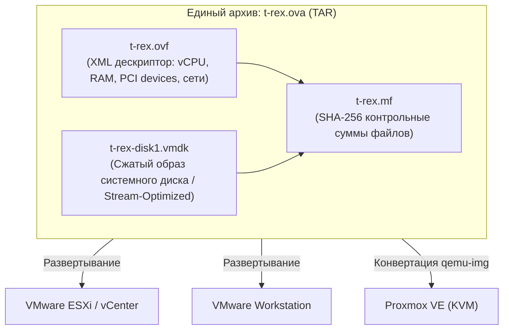

# Руководство по экспорту и переносу виртуальной машины TRex на другой хост в формате OVF/OVA

> **Назначение:** Практическая инструкция по подготовке, экспорту текущей эталонной ВМ генератора трафика **t-rex** в открытый формат виртуализации **OVF (Open Virtualization Format)** или единый архив **OVA**, передаче на новый гипервизор и последующему развертыванию (VMware ESXi, vCenter, Workstation, Proxmox VE).  
> **Дата разработки:** Октябрь 2026 г.

---

## 📑 Содержание
1. [Архитектура пакета OVF/OVA и состав артефактов](#1-архитектура-пакета-ovfova-и-состав-артефактов)
2. [Подготовка операционной системы перед экспортом (Sanitization)](#2-подготовка-операционной-системы-перед-экспортом-sanitization)
3. [Экспорт виртуальной машины в OVF/OVA](#3-экспорт-виртуальной-машины-в-ovfova)
   - [3.1. Экспорт через VMware Host Client (ESXi Web UI)](#31-экспорт-через-vmware-host-client-esxi-web-ui)
   - [3.2. Экспорт через консольную утилиту ovftool (Рекомендуемый способ)](#32-экспорт-через-консольную-утилиту-ovftool-рекомендуемый-способ)
   - [3.3. Экспорт из VMware Workstation / Fusion](#33-экспорт-из-vmware-workstation--fusion)
4. [Передача дистрибутива OVF на целевой сервер](#4-передача-дистрибутива-ovf-на-целевой-сервер)
5. [Импорт и развертывание на целевом гипервизоре](#5-импорт-и-развертывание-на-целевом-гипервизоре)
   - [5.1. Развертывание на VMware ESXi / vCenter](#51-развертывание-на-vmware-esxi--vcenter)
   - [5.2. Развертывание на VMware Workstation](#52-развертывание-на-vmware-workstation)
   - [5.3. Импорт в среду Proxmox VE (KVM)](#53-импорт-в-среду-proxmox-ve-kvm)
6. [Пост-миграционная проверка и запуск стенда](#6-пост-миграционная-проверка-и-запуск-стенда)

---

## 1. Архитектура пакета OVF/OVA и состав артефактов

Формат OVF представляет собой стандарт DMTF (Distributed Management Task Force) для независимой упаковки и распространения виртуальных машин.



---

## 2. Подготовка операционной системы перед экспортом (Sanitization)

Чтобы перенесённая ВМ корректно запустилась на новом хосте без конфликтов IP, дублирования сетевых идентификаторов и лишнего мусора в образе диска, выполните процедуру очистки внутри ВМ `t-rex`.

Подключитесь к ВМ по SSH и выполните команды:

```bash
# 1. Остановка рабочих служб генератора
sudo systemctl stop trex-engine.service
sudo systemctl stop trex-webui.service

# 2. Очистка кэша пакетов APT
sudo apt-get clean
sudo apt-get autoremove --purge -y

# 3. Ротация и очистка системных логов journald (освобождает гигабайты места)
sudo journalctl --vacuum-time=1d
sudo rm -rf /var/log/*.gz /var/log/*.[0-9] /var/log/syslog.*

# 4. Очистка временных директорий
sudo rm -rf /tmp/* /var/tmp/* /opt/trex/v3.08/data/tmp/*

# 5. Очистка истории поиска и тестовых дампов PCAP
sudo rm -f /opt/trex/v3.08/astf/pcaps/*.pcap
sudo rm -f /opt/trex/webui/reports_history.json
echo "[]" | sudo tee /opt/trex/webui/reports_history.json

# 6. Сброс Machine ID (для предотвращения конфликтов IP по DHCP при клонировании)
sudo truncate -s 0 /etc/machine-id
sudo rm -f /var/lib/dbus/machine-id
sudo ln -sf /etc/machine-id /var/lib/dbus/machine-id

# 7. Очистка истории команд bash
history -c
cat /dev/null > ~/.bash_history
cat /dev/null > /home/user/.bash_history

# 8. Обнуление свободного пространства для максимального сжатия VMDK диска (опционально)
sudo dd if=/dev/zero of=/zero.fill bs=1M status=progress || true
sudo rm -f /zero.fill
sync

# 9. Корректное выключение ВМ
sudo shutdown -h now
```

---

## 3. Экспорт виртуальной машины в OVF/OVA

> [!IMPORTANT]
> Экспорт виртуальной машины выполняется **только при полностью выключенном состоянии (Powered Off)**. Наличие активных снапшотов не рекомендуется — удалите или объедините (Consolidate) все снапшоты перед экспортом.

### 3.1. Экспорт через VMware Host Client (ESXi Web UI)

1. Откройте веб-интерфейс ESXi: `https://<IP_ESXi_HOST>/ui`.
2. В левом меню перейдите в раздел **Virtual Machines** (Виртуальные машины).
3. Найдите ВМ `t-rex`, нажмите правой кнопкой мыши и убедитесь, что она выключена.
4. Выберите пункт **Export** (Экспорт):
   * Откроется диалоговое окно со списком скачиваемых файлов (`.ovf`, `.mf`, `.vmdk`).
   * Нажмите кнопку **Export**.
5. Браузер последовательно загрузит файлы:
   * `t-rex.ovf` — XML-дескриптор.
   * `t-rex.mf` — манифест контрольных сумм.
   * `t-rex-disk1.vmdk` — сжатый образ виртуального диска.
6. Поместите все скачанные файлы в единый каталог на рабочем АРМ.

---

### 3.2. Экспорт через консольную утилиту ovftool (Рекомендуемый способ)

Утилита **VMware OVF Tool** (`ovftool`) позволяет выполнить экспорт напрямую в единый самодостаточный архив `.ova` с максимальным коэффициентом сжатия и проверкой целостности.

Утилита входит в состав VMware Workstation или устанавливается отдельно (доступна под Linux, Windows, macOS).

#### Команда экспорта с ESXi в OVA:
```bash
# Синтаксис:
# ovftool vi://<USER>:<PASS>@<ESXi_IP>/<VM_NAME> <TARGET_PATH>/<NAME>.ova

ovftool --noSSLVerify \
  --diskMode=streamOptimized \
  vi://<ESXI_USER>:<ESXI_PASSWORD>@<ESXI_HOST_IP>/<VM_NAME> \
  ./t-rex_appliance_v3.08.ova
```

#### Команда экспорта из локального VMX (VMware Workstation):
```bash
ovftool /var/lib/vmware/Virtual\ Machines/t-rex/t-rex.vmx ./t-rex_appliance_v3.08.ova
```

Процесс отображает индикатор прогресса (Progress: 0% .. 100%) и завершается созданием файла `t-rex_appliance_v3.08.ova`.

---

### 3.3. Экспорт из VMware Workstation / Fusion
1. Откройте VMware Workstation.
2. Выберите виртуальную машину `t-rex`.
3. В верхнем меню выберите **File** -> **Export to OVF...**.
4. Укажите каталог сохранения и имя файла `t-rex.ovf`.
5. Дождитесь завершения экспорта диска.

---

## 4. Передача дистрибутива OVF на целевой сервер

Перенесите полученный `.ova` архив или комплект файлов (`.ovf` + `.vmdk`) на целевой хост с использованием `rsync` или `scp` с отображением прогресса:

```bash
# Передача на целевой сервер по SSH
rsync -avP ./t-rex_appliance_v3.08.ova root@<IP_ЦЕЛЕВОГО_ХОСТА>:/tmp/
```

Либо загрузите файл через веб-интерфейс целевого гипервизора.

---

## 5. Импорт и развертывание на целевом гипервизоре

### 5.1. Развертывание на VMware ESXi / vCenter

1. Откройте веб-клиент целевого ESXi: `https://<НОВЫЙ_ESXi_IP>/ui`.
2. Нажмите **Create / Register VM** (Создать / Зарегистрировать ВМ).
3. Выберите тип развертывания: **Deploy a virtual machine from an OVF or OVA file** -> Нажмите **Next**.
4. Введите имя новой ВМ (например, `t-rex-ngfw-tester`) и перетащите файлы `t-rex.ovf` и `t-rex-disk1.vmdk` (или единый файл `t-rex_appliance_v3.08.ova`).
5. Выберите целевой **Datastore** (хранилище).
6. **Сопоставление сетей (Network Mapping):**
   * В окне развертывания будет предложено связать 3 сетевых адаптера ВМ с физическими vSwitch/PortGroup нового хоста:
     * **Source Network: VM Network (Management)** -> свяжите с вашей сетью управления (MGMT).
     * **Source Network: Port 0 (Client)** -> свяжите с отдельным изолированным виртуальным коммутатором или VLAN LAN NGFW.
     * **Source Network: Port 1 (Server)** -> свяжите с изолированным vSwitch или VLAN WAN NGFW.
   * **Disk Provisioning:** выберите `Thin` (тонкий диск для экономии пространства) или `Thick Provision Eager Zeroed` (максимальная скорость I/O для DPDK).
7. Завершите мастер и дождитесь окончания загрузки и конвертации диска.

> [!CAUTION]
> **Обязательная настройка vSwitch на новом ESXi:**  
> Перейдите в свойства виртуальных коммутаторов (или PortGroup), к которым подключены Port 0 и Port 1, в раздел **Security** и включите:
> * **Promiscuous Mode = Accept** (Обязательно! Иначе TRex не сможет получать чужие MAC-адреса генерируемых клиентов и серверов).
> * **MAC Address Changes = Accept**.
> * **Forged Transmits = Accept**.

---

### 5.2. Развертывание на VMware Workstation
1. Запустите VMware Workstation.
2. Перейдите в меню **File** -> **Open...**.
3. Выберите файл `t-rex_appliance_v3.08.ova` (или `t-rex.ovf`).
4. Задайте имя ВМ и каталог размещения.
5. Нажмите **Import**.
6. После импорта откройте **Virtual Machine Settings**:
   * Адаптер 1: настройте режим `Bridged` или `NAT` для доступа по IP к веб-интерфейсу.
   * Адаптеры 2 и 3: переведите в режимы `LAN Segment` или `Custom (VMnet)` для прямой связи с интерфейсами виртуального NGFW.
7. Включите ВМ.

---

### 5.3. Импорт в среду Proxmox VE (KVM)

В Proxmox VE развертывание OVA выполняется через распаковку и импорт диска в созданную KVM-машину:

```bash
# 1. Распаковка OVA архива на хосте Proxmox
mkdir /tmp/trex_import && cd /tmp/trex_import
tar -xvf /tmp/t-rex_appliance_v3.08.ova

# 2. Создание виртуальной машины в Proxmox (ID 150)
qm create 150 \
  --name t-rex-generator \
  --memory 8192 \
  --cores 4 \
  --cpu host \
  --ostype l26 \
  --scsihw virtio-scsi-pci \
  --net0 vmxnet3,bridge=vmbr0 \
  --net1 vmxnet3,bridge=vmbr1 \
  --net2 vmxnet3,bridge=vmbr2

# 3. Импорт VMDK диска в пул хранения (например, local-lvm)
qm importdisk 150 t-rex-disk1.vmdk local-lvm -format qcow2

# 4. Подключение диска как загрузочного SCSI
qm set 150 --scsi0 local-lvm:vm-150-disk-0,boot=on
qm set 150 --boot order=scsi0

# 5. Запуск ВМ
qm start 150
```

---

## 6. Пост-миграционная проверка и запуск стенда

После запуска виртуальной машины на новом оборудовании выполните контрольную проверку аппаратных привязок DPDK:

### 1. Подключение к ВМ по SSH:
```bash
ssh <ИМЯ_ПОЛЬЗОВАТЕЛЯ>@<НОВЫЙ_IP_АДРЕС>
# Пароль: ваш пароль учетной записи ОС Linux
```

### 2. Проверка PCI-адресов адаптеров:
На новом хосте или при изменении слотов гипервизора PCI-адреса могут измениться:
```bash
lspci | grep -i eth
```
Если адреса адаптеров VMXNET3 изменились (например, стали `04:00.0` вместо `03:00.0`):
1. Откройте конфигурационный файл:
   ```bash
   sudo nano /etc/trex_cfg.yaml
   ```
2. Обновите строку `interfaces: ['04:00.0', '0c:00.0']`.
3. Перезапустите службы:
   ```bash
   sudo systemctl restart trex-engine
   sudo systemctl restart trex-webui
   ```

### 3. Проверка статуса служб и веб-панели:
```bash
sudo systemctl status trex-engine trex-webui
```
Откройте браузер по новому адресу: **`http://<НОВЫЙ_IP_АДРЕС>:8080/`**  
Убедитесь, что пилюля статуса горит зелёным цветом (*«Активен»*), нажмите **«🔄 ARP»** для разрешения шлюзов NGFW. Стенд готов к проведению нагрузочных тестов!
EOF
