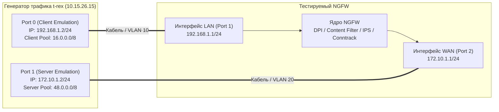

# Руководство администратора: Эксплуатация веб-панели управления TRex Studio и интеграция с NGFW

> **Назначение:** Полное техническое руководство администратора тестового стенда по установке, запуску, удалению, детальной работе с графическим веб-интерфейсом **TRex Studio (v3.08)**, а также по конфигурированию целевого межсетевого экрана (NGFW) для проведения стресс-тестирования и проверки модулей DPI.  
> **Дата разработки:** Октябрь 2026 г.

---

## 📑 Содержание
1. [Архитектура программного комплекса TRex Studio](#1-архитектура-программного-комплекса-trex-studio)
2. [Управление службами: запуск, перезапуск, проверка статуса](#2-управление-службами-запуск-перезапуск-проверка-статуса)
3. [Процедура полного удаления веб-интерфейса](#3-процедура-полного-удаления-веб-интерфейса)
4. [Подробное описание веб-интерфейса (Каждый элемент управления)](#4-подробное-описание-веб-интерфейса-каждый-элемент-управления)
   - [4.1. Верхняя панель (Top Bar) и статус-индикаторы](#41-верхняя-панель-top-bar-и-статус-индикаторы)
   - [4.2. Мониторинг ресурсов сервера (Server Health)](#42-мониторинг-ресурсов-сервера-server-health)
   - [4.3. Баннер вердикта испытаний (Verdict Banner)](#43-баннер-вердикта-испытаний-verdict-banner)
   - [4.4. Вкладка «📊 Дашборд & Нагрузка»](#44-вкладка-дашборд--нагрузка)
   - [4.5. Вкладка «🕵️‍♂️ Проверка DPI / Приложений»](#45-вкладка-проверка-dpi--приложений)
   - [4.6. Вкладка «📑 Журнал ПМИ»](#46-вкладка-журнал-пми)
   - [4.7. Вкладка «⚙️ Сеть стенда»](#47-вкладка-сеть-стенда)
   - [4.8. Вкладка «👥 Пользователи ОС»](#48-вкладка-пользователи-ос)
5. [Схема сети стенда и настройка межсетевого экрана (NGFW)](#5-схема-сети-стенда-и-настройка-межсетевого-экрана-ngfw)
   - [5.1. Топология и матрица IP-адресации](#51-топология-и-матрица-ip-адресации)
   - [5.2. Настройка статической маршрутизации на NGFW](#52-настройка-статической-маршрутизации-на-ngfw)
   - [5.3. Настройка правил межсетевого экрана и NAT](#53-настройка-правил-межсетевого-экрана-и-nat)
   - [5.4. Настройка модуля глубокого анализа пакетов (DPI)](#54-настройка-модуля-глубокого-анализа-пакетов-dpi)

---

## 1. Архитектура программного комплекса TRex Studio

Веб-панель **TRex Studio** разработана на базе Python 3 / Flask, взаимодействует с ядром генератора трафика через официальный клиентский RPC API (`trex.astf.api`) и интегрирована с подсистемой аутентификации ОС Linux (PAM / `/etc/shadow`).

```mermaid
graph LR
    subgraph Browser ["Рабочее место инженера (Браузер)"]
        UI["Web UI: http://10.15.26.15:8080<br/>HTML5 / Dark Glassmorphism / Chart.js"]
    end

    subgraph Host ["Сервер t-rex (Ubuntu 22.04 LTS)"]
        subgraph WebService ["Служба: trex-webui.service"]
            Flask["Flask Backend (app.py)<br/>Security: Login PAM, CSRF, Rate-limit"]
            Cache["Кэш телеметрии (500 мс)"]
            ProfilesGen["Генератор L7 профилей DPI"]
        end

        subgraph CoreService ["Служба: trex-engine.service"]
            Engine["Движок TRex ASTF (_t-rex-64)<br/>RPC TCP 4500 / Pub TCP 4501"]
            DPDK["DPDK Ring Buffers<br/>Hugepages 2048 MB"]
        end

        subgraph LinuxOS ["Операционная система"]
            Shadow["/etc/shadow (spwd/crypt)"]
            YAML["/etc/trex_cfg.yaml"]
        end
    end

    UI <==> |HTTP / JSON REST API| Flask
    Flask --> Shadow
    Flask --> YAML
    Flask <==> |TRex RPC API (Port 4500)| Engine
    Engine <==> DPDK
```

---

## 2. Управление службами: запуск, перезапуск, проверка статуса

Управление комплексом осуществляется через стандартный менеджер служб `systemd`:

### Команды управления:
```bash
# 1. Запуск обеих служб
sudo systemctl start trex-engine.service
sudo systemctl start trex-webui.service

# 2. Остановка служб
sudo systemctl stop trex-webui.service
sudo systemctl stop trex-engine.service

# 3. Перезапуск веб-интерфейса (например, после обновления скриптов)
sudo systemctl restart trex-webui.service

# 4. Проверка статуса служб
sudo systemctl status trex-engine.service trex-webui.service

# 5. Просмотр логов в реальном времени
sudo journalctl -u trex-webui.service -f
sudo journalctl -u trex-engine.service -f
```

---

## 3. Процедура полного удаления веб-интерфейса

Если требуется удалить веб-панель и вернуть сервер в исходное состояние (только консольный TRex CLI):

```bash
# 1. Остановка и отключение автозагрузки службы Web UI
sudo systemctl stop trex-webui.service
sudo systemctl disable trex-webui.service

# 2. Удаление systemd-юнита
sudo rm -f /etc/systemd/system/trex-webui.service
sudo systemctl daemon-reload

# 3. Удаление исходного кода веб-интерфейса (с сохранением резервных копий)
sudo rm -rf /opt/trex/webui

# 4. Проверка: ядро TRex продолжает работать штатно через CLI
sudo systemctl restart trex-engine.service
sudo systemctl status trex-engine.service
```

Для повторной установки достаточно восстановить каталог из бекапа:
```bash
sudo cp -r /opt/trex/webui_backup_2_20261026_161353 /opt/trex/webui
sudo systemctl daemon-reload && sudo systemctl enable --now trex-webui.service
```

---

## 4. Подробное описание веб-интерфейса (Каждый элемент управления)

Вход в панель управления: **`http://10.15.26.15:8080/`**.  
Авторизация осуществляется логином и паролем системного пользователя ОС (например, `user` / `xxXX1234`).

---

### 4.1. Верхняя панель (Top Bar) и статус-индикаторы

```
[⚡ TRex Studio L7]  [🕒 15:45:02 | 🌐 10.15.26.15]  [📊 Дашборд] [🕵️‍♂️ DPI] [📑 ПМИ] [⚙️ Сеть] [👥 Пользователи]  [🟢 Активен (CPU: 2.1%)] [👤 user] [Выйти]
```

* **Логотип «⚡ TRex Studio L7»**: Название комплекса тестирования прикладного трафика.
* **Часы реального времени и IP-хоста**: Отображают локальное системное время сервера и IP интерфейса управления для контроля актуальности сеанса.
* **Навигационные кнопки-вкладки (Segmented Nav)**:
  * `📊 Дашборд & Нагрузка` — основной экран управления генерацией и графиков.
  * `🕵️‍♂️ Проверка DPI / Приложений` — модуль формирования синтетических L7-запросов и сигнатурного анализа.
  * `📑 Журнал ПМИ` — архив протоколов испытаний с кнопками скачивания.
  * `⚙️ Сеть стенда` — онлайн-редактор адресов тестовых портов TRex.
  * `👥 Пользователи ОС` — панель управления локальными учётными записями Linux.
* **Пилюля статуса «Активен / Движок выключен»**:
  * **Зелёный светящийся индикатор**: Служба `trex-engine` запущена, сокет RPC 4500 доступен, ядро готово к генерации. Отображается загрузка CPU worker-потоков.
  * **Красный индикатор**: Ядро остановлено или произошла аппаратная ошибка привязки DPDK.
* **Бейдж «👤 user»**: Показывает имя пользователя ОС, под которым выполнен вход.
* **Кнопка «Выйти»**: Очищает сессионные куки и возвращает на экран входа `/login`.

---

### 4.2. Мониторинг ресурсов сервера (Server Health)

* **Load Avg**: Отображает среднюю загрузку CPU виртуальной машины за 1, 5 и 15 минут (`getloadavg()`). Значения выше 4.0 свидетельствуют о высокой нагрузке на гипервизоре.
* **Шкала RAM**: Процент утилизации оперативной памяти хоста. Синяя полоса наглядно отражает состояние ОЗУ.
* **Шкала DISK**: Процент заполнения корневого раздела `/`. Фиолетовая полоса позволяет контролировать свободное место при формировании больших дампов трафика.

---

### 4.3. Баннер вердикта испытаний (Verdict Banner)

Интеллектуальный баннер в реальном времени анализирует поведение NGFW и выносит вердикт:
* `✦ Система готова к проведению испытаний` (Нейтральный фон): Генерация остановлена, система ожидает запуска.
* `⚡ ИДЕТ ТЕСТИРОВАНИЕ...` (Синий фон): Трафик отправляется, идёт сбор телеметрии.
* `🟢 ПРОПУЩЕНО (PASSED)` (Зелёный фон): Трафик успешно проходит сквозь межсетевой экран, сессии устанавливаются без аномальных задержек и сбросов.
* `🛡️ ЗАБЛОКИРОВАНО (BLOCKED BY DPI)` (Красный фон): Запросы уходят от клиента, но блокируются модулем фильтрации приложений (DPI) или правилами Firewall NGFW (фиксируются пакеты RST, таймауты или разрывы SYN).
* **Кнопка «📌 Зафиксировать в ПМИ»**: Принудительно сохраняет метрики текущего незавершенного теста в историю.
* **Кнопка «📥 Скачать ПМИ (.md)»**: Скачивает сформированный протокол испытаний в формате Markdown.
* **Кнопка «✕»**: Скрывает баннер и переводит его в нейтральное состояние ожидания.

---

### 4.4. Вкладка «📊 Дашборд & Нагрузка»

#### Блок параметров запуска:
1. **Сценарий / Приложение L7 (с быстрым поиском)**:
   * Выпадающий интерактивный список с полем живого поиска.
   * **`astf/http_simple.py` — HTTP Базовый**: непрерывный поток L7 HTTP GET запросов (размер ответа 2 КБ). Идеален для измерения чистой пропускной способности и предельного CPS.
   * **`astf/sfr.py` — Корпоративный микс (SFR)**: смесь реального корпоративного трафика (HTTP, HTTPS, DNS, IMAP, SMTP, FTP, Video). Имитирует поведение сотен офисных сотрудников.
   * **`astf/http_https.py` — HTTP + HTTPS Микс**: комбинированная нагрузка открытого и зашифрованного трафика для проверки SSL-инспекции NGFW.
   * **`astf/emix2.py` — EMIX Пакетный микс**: Enterprise Mix пакетов различной длины (64, 570, 1518 байт) для стресс-теста сетевого стека и очередей сетевых карт.
2. **Множитель (-m)**: Числовой коэффициент масштабирования сессий (CPS — Connections Per Second). Например, значение `500` запускает генерацию с частотой 500 новых TCP-сессий в секунду.
3. **Длительность (-d)**: Время проведения испытания в секундах (по умолчанию 300 сек). По истечении времени тест автоматически плавно завершается.
4. **Кнопка «▶ Запустить генерацию» / «⏹ Остановить поток (Активен)»**:
   * В неактивном состоянии горит зеленым. При нажатии активирует профиль нагрузки.
   * Во время теста кнопка окрашивается в пульсирующий красный цвет и позволяет в любой момент экстренно остановить генерацию трафика.
5. **Кнопка «🔄 ARP»**:
   * Принудительно отправляет широковещательные ARP-запросы с обоих портов генератора к шлюзам NGFW (`192.168.1.1` и `172.10.1.1`).
   * Сопровождается анимацией и всплывающим уведомлением с подтверждением полученных MAC-адресов.
6. **Чипы «⚡ Нагрузка на лету» (`x10`, `x100`, `x500`, `x1000`, `x2500`, `x5000`)**:
   * Кнопки ступенчатого изменения нагрузки. Позволяют на ходу повышать интенсивность трафика без остановки теста, выявляя порог деградации NGFW.

#### Блок метрик реального времени (Сетка 6 карточек):
* **Отправка (TX)**: Скорость передачи пакетов с клиентского порта TRex (Мбит/с).
* **Прием (RX)**: Скорость получения пакетов на серверном порту (Мбит/с). Разница между TX и RX показывает объём дропов на NGFW.
* **Скорость PPS**: Пакетная производительность (килопакетов в секунду, Kpps).
* **Новых сессий (CPS)**: Реальное количество успешно инициируемых сессий в секунду.
* **Активные потоки**: Количество параллельно удерживаемых TCP/L7 сессий в таблице состояний генератора.
* **Сбросы (Drops)**: Суммарное количество отброшенных пакетов.

#### Блок расширенной телеметрии TCP/L7 (Сетка 8 карточек):
* **Попыток соединений (SYN)**: Сколько всего SYN-пакетов отправлено клиентами.
* **Успешно установлено (SYN-ACK)**: Сколько соединений успешно прошли трехстороннее рукопожатие TCP (3-way handshake).
* **Суммарный объем L7 (TX / RX)**: Совокупный объём переданных полезных данных в мегабайтах.
* **Перегрузка очередей (Queue Full)**: Индикатор переполнения буферов DPDK. Должен быть равен 0.
* **Корректно закрыто (FIN)**: Сессии, штатно завершенные обменом FIN/ACK пакетами.
* **Заблокировано NGFW (RST / Drop)**: Сессии, разорванные пакетами TCP RST со стороны NGFW или сброшенные по тайм-ауту.
* **Таймауты / Retransmits**: Пакеты, отправленные повторно из-за отсутствия ответа (потеря пакетов на NGFW).
* **Ошибки интерфейсов L2 (NIC Errors)**: Аппаратные ошибки сетевых карт (падение фреймов по CRC, переполнение RX/TX rings).

#### Графики реального времени и таблица портов L2:
* **График «Пропускная способность L7»**: Синяя линия — исходящий битрейт (TX), зеленая линия — входящий битрейт (RX). Наглядно демонстрирует полку максимальной пропускной способности.
* **График «Установка сессий (CPS)»**: Фиолетовая линия динамики открытия новых сессий.
* **Таблица портов L2**: Статистика на канальном уровне: скорость (Мбит/с) и количество пакетов раздельно для Port 0 (Клиент) и Port 1 (Сервер).

---

### 4.5. Вкладка «🕵️‍♂️ Проверка DPI / Приложений»

Модуль предназначен для проверки эффективности сигнатурного анализа и правил фильтрации приложений (Application Control) межсетевого экрана.

* **Поле ввода «Домен»**: Позволяет вручную вписать любой FQDN домен или выбрать из выпадающего списка:
  * ВКонтакте (`vk.com`)
  * WhatsApp (`web.whatsapp.com`)
  * Telegram (`web.telegram.org`)
  * Discord (`discord.com`)
  * YouTube (`youtube.com`)
  * TikTok (`tiktok.com`)
  * RuTracker (`rutracker.org`)
  * Pornhub (`pornhub.com`)
  * ChatGPT (`chatgpt.com`)
  * Яндекс (`ya.ru` — эталонный разрешенный домен)
* **Селектор «Инкапсуляция»**:
  * `🔒 HTTPS TLS 1.2 (SNI 443)`: TRex генерирует валидный бинарный пакет TLS Client Hello, вкладывая целевой домен в расширение Server Name Indication (SNI).
  * `🌐 HTTP/1.1 (Host 80)`: TRex отправляет текстовый HTTP GET-запрос с указанием домена в заголовке `Host:`.
* **Поле «Множитель»**: Интенсивность проверочных сессий (по умолчанию 25 CPS).
* **Кнопка «▶ Запустить проверку DPI»**: Генерирует изолированный Python-сценарий в `/opt/trex/v3.08/astf/custom/`, компилирует его и запускает на 120 секунд с мгновенной фиксацией блокировки или пропуска на баннере вердикта.
* **Чипы быстрого выбора сигнатур**: Кнопки в один клик для моментального выбора популярных сервисов.

---

### 4.6. Вкладка «📑 Журнал ПМИ»

Содержит архив результатов всех проведенных испытаний:
* **Таблица журнала**:
  * **Время**: Дата и точное время завершения теста.
  * **Сценарий / Профиль**: Имя профиля нагрузки или проверенного домена DPI.
  * **TX / RX Пик**: Зафиксированные максимальные скорости передачи и приёма.
  * **Вердикт DPI/NGFW**: Итоговый результат (зелёный `🟢 ПРОПУЩЕНО` или красный `🛡️ ЗАБЛОКИРОВАНО`).
  * **Кнопка «📥 Скачать»**: Выгружает индивидуальный структурированный отчет в формате Markdown именно по этой тестовой сессии.
* **Кнопка «📥 Скачать текущий отчет (.md)»**: Формирует отчёт по текущему или последнему активному тесту.
* **Кнопка «🗑️ Очистить журнал»**: Очищает файл истории `reports_history.json` с подтверждением.

---

### 4.7. Вкладка «⚙️ Сеть стенда»

Позволяет изменять топологическую адресацию тестовых портов TRex без правки конфигурационных файлов через SSH:
* **Port 0 IP**: IP-адрес клиентского порта (по умолчанию `192.168.1.2`).
* **Port 0 Шлюз NGFW**: IP-адрес интерфейса LAN межсетевого экрана (по умолчанию `192.168.1.1`).
* **Port 1 IP**: IP-адрес серверного порта (по умолчанию `172.10.1.2`).
* **Port 1 Шлюз NGFW**: IP-адрес интерфейса WAN межсетевого экрана (по умолчанию `172.10.1.1`).
* **Кнопка «💾 Сохранить и перезапустить движок TRex»**:
  * Валидирует корректность всех введённых IPv4-адресов.
  * Перезаписывает конфигурационный файл `/etc/trex_cfg.yaml`.
  * Автоматически перезапускает службу `trex-engine.service`.

---

### 4.8. Вкладка «👥 Пользователи ОС»

Раздел администрирования учётных записей операционной системы Linux:
* **Форма создания пользователя**:
  * Поля: «Имя пользователя (логин)», «Пароль», «Подтверждение пароля».
  * Чекбокс: *«Предоставить права администратора (sudo)»*.
  * Кнопка: **«Создать пользователя»** — регистрирует системную учётную запись с домашней папкой и оболочкой bash. Пользователь сможет подключаться как к веб-интерфейсу, так и по SSH.
* **Таблица пользователей**:
  * Отображает всех реальных пользователей ОС (с UID >= 1000 и root).
  * Кнопка **«🔑 Пароль»** — вызов диалогового окна смены пароля пользователю без перезагрузки.
  * Кнопка **«🗑️»** — удаление пользователя и его домашней директории (с защитой от удаления root и собственной активной сессии).

---

## 5. Схема сети стенда и настройка межсетевого экрана (NGFW)

Для того чтобы межсетевой экран корректно маршрутизировал и анализировал сгенерированный трафик TRex, необходимо настроить интерфейсы, статические маршруты и политики безопасности.

### 5.1. Топология и матрица IP-адресации



#### Матрица адресации стенда:
| Узел / Устройство | Интерфейс | IP-адрес / Маска | Назначение |
|---|---|---|---|
| **TRex VM** | `ens33` | `10.15.26.15/24` | Управление: Web UI (порт 8080), SSH (порт 22). |
| **TRex VM** | `Port 0` (03:00.0) | `192.168.1.2/24` | Клиентский порт (эмуляция генерации запросов). |
| **TRex VM** | `Port 1` (0b:00.0) | `172.10.1.2/24` | Серверный порт (эмуляция ответов сервисов). |
| **NGFW** | `LAN` (eth1) | `192.168.1.1/24` | Входной шлюз для клиентов TRex. |
| **NGFW** | `WAN` (eth2) | `172.10.1.1/24` | Выходной шлюз для серверов TRex. |
| **TRex Clients Pool** | Виртуальный | `16.0.0.0/8` | IP-адреса генерируемых клиентов (16.0.0.1 – 16.0.0.254). |
| **TRex Servers Pool** | Виртуальный | `48.0.0.0/8` | IP-адреса виртуальных веб-серверов (48.0.0.1 – 48.0.0.20). |

---

### 5.2. Настройка статической маршрутизации на NGFW

По умолчанию межсетевой экран не знает, где находятся виртуальные сети клиентов (`16.0.0.0/8`) и серверов (`48.0.0.0/8`). Необходимо прописать два статических маршрута:

1. **Маршрут к пулу клиентов (Client Pool):**
   * **Сеть назначения:** `16.0.0.0/8` (или `16.0.0.0` маска `255.0.0.0`)
   * **Шлюз (Next Hop):** `192.168.1.2` (Port 0 TRex)
   * **Интерфейс:** `LAN`
2. **Маршрут к пулу серверов (Server Pool):**
   * **Сеть назначения:** `48.0.0.0/8` (или `48.0.0.0` маска `255.0.0.0`)
   * **Шлюз (Next Hop):** `172.10.1.2` (Port 1 TRex)
   * **Интерфейс:** `WAN`

> [!IMPORTANT]
> Если ваш NGFW работает под управлением Linux (например, шлюз на базе nftables/iptables), эквивалентные команды в консоли:
> ```bash
> ip route add 16.0.0.0/8 via 192.168.1.2 dev eth1
> ip route add 48.0.0.0/8 via 172.10.1.2 dev eth2
> ```

---

### 5.3. Настройка правил межсетевого экрана и NAT

#### 1. Отключение NAT (Bypass NAT / No-NAT)
В реальной сети NGFW транслирует локальные адреса в свой внешний WAN-адрес (SNAT/Masquerade).  
При тестировании производительности на миллионах пакетов механизм SNAT быстро переполнит таблицу портов (65535 портов на IP).  
**Решение:** Создайте правило исключения из NAT для тестовых сетей:
* **Source:** `16.0.0.0/8`
* **Destination:** `48.0.0.0/8`
* **Action:** `No-NAT` / `Do not Translate` (Маршрутизация без изменения адресов).

#### 2. Разрешающее правило межсетевого экрана (Firewall Policy)
Создайте базовое разрешающее правило:
* **Source Zone / Interface:** `LAN`
* **Source IP:** `16.0.0.0/8` (или Any)
* **Destination Zone / Interface:** `WAN`
* **Destination IP:** `48.0.0.0/8` (или Any)
* **Service / Ports:** `HTTP (80)`, `HTTPS (443)`, `Any`
* **Action:** `Allow` (Пропустить)

#### 3. Настройка защиты от DoS и лимитов сессий (Syn-Flood Protection)
Если на NGFW включен модуль защиты от DoS/SYN-флуда, высокая скорость открытия сессий TRex (от 1000 до 50000 CPS) может быть ошибочно воспринята как атака.
* Добавьте сеть `16.0.0.0/8` в исключения (Whitelist) модуля защиты от DoS или временно увеличьте пороговые значения `Max SYN packets / sec` до `100000`.

---

### 5.4. Настройка модуля глубокого анализа пакетов (DPI)

Для демонстрации блокировки приложений (Вкладка «Проверка DPI»):

1. **Создание запрещающего правила для Telegram:**
   * В веб-интерфейсе NGFW перейдите в раздел **Контроль приложений (Application Control / DPI)**.
   * Создайте правило:
     * **Приложение / Категория:** `Telegram` (или протокол `Telegram Messenger`).
     * **Действие:** `Drop / Reject` (Блокировать).
2. **Проверка через TRex Studio:**
   * Откройте вкладку **«Проверка DPI / Приложений»**.
   * Выберите домен `web.telegram.org`, протокол `TLS 1.2 (SNI 443)`.
   * Нажмите **«▶ Запустить проверку DPI»**.
   * Через несколько секунд на дашборде TRex загорится красный баннер:  
     **`🛡️ ЗАБЛОКИРОВАНО (BLOCKED BY DPI)`**.
   * В журнале NGFW появится запись о срабатывании правила с блокировкой сессии клиента из пула `16.0.0.0/8`.
3. **Проверка эталонного домена:**
   * Выберите домен `ya.ru` (Яндекс).
   * Нажмите запуск — баннер загорится зелёным: **`🟢 ПРОПУЩЕНО (PASSED)`**.
EOF
