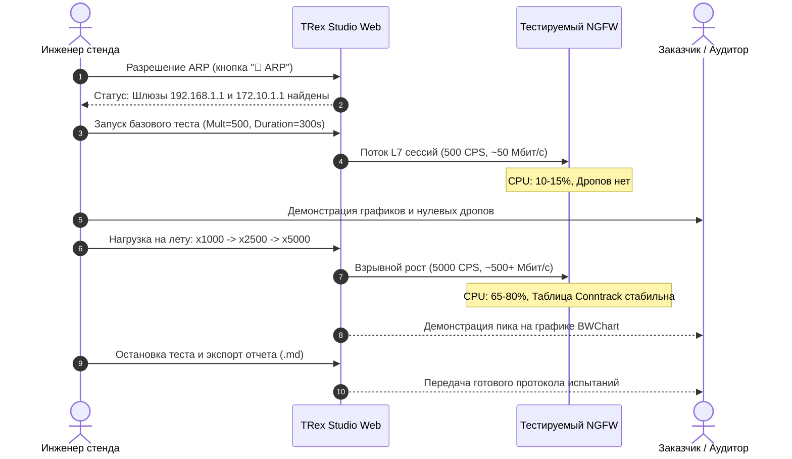

# Демонстрационный сценарий №1: Предельная пропускная способность (L7 Throughput) и скорость открытия сессий (CPS)

> **Назначение:** Шаблон программы и методики демонстрации (ПМИ) для заказчика. Позволяет наглядно подтвердить заявленные паспортные характеристики межсетевого экрана (NGFW) по максимальной пропускной способности прикладного трафика (Мбит/с) и максимальной скорости установки новых TCP-соединений в секунду (Connections Per Second, CPS).  
> **Профиль нагрузки:** `astf/http_simple.py` (HTTP GET 2KB)  
> **Время проведения:** 15–20 минут.

---

## 🎯 1. Цели демонстрации
1. Продемонстрировать заказчику пиковую пропускную способность NGFW на реальном L7 HTTP-трафике с полным трехсторонним рукопожатием (3-way handshake).
2. Зафиксировать максимальную скорость генерации и обработки новых сессий (CPS) без деградации времени отклика.
3. Продемонстрировать поведение аппаратных ресурсов NGFW (CPU Core Utilization, RAM, сетевые очереди) при приближении к пределу нагрузки.

---

## 📋 2. План проведения демонстрации

---

## 🛠️ 3. Пошаговые действия оператора

### Этап 1: Подготовка стенда
1. Откройте в браузере веб-панель TRex: `http://10.15.26.15:8080/`.
2. В параллельной вкладке откройте панель управления NGFW (раздел мониторинга CPU, памяти и интерфейсов).
3. В веб-панели TRex нажмите кнопку **«🔄 ARP»**.
   * *Ожидаемый результат:* Во всплывающем окне отобразится:  
     `ARP шлюзов разрешен! Port 0 (192.168.1.1) → 00:0c:... | Port 1 (172.10.1.1) → 00:0c:...`.

### Этап 2: Базовый прогон (Оценка нормальной работы)
1. На вкладке **«📊 Дашборд & Нагрузка»**:
   * **Сценарий:** выберите `astf/http_simple.py — HTTP Базовый`.
   * **Множитель (-m):** введите `500`.
   * **Длительность (-d):** введите `300` (5 минут).
2. Нажмите кнопку **«▶ Запустить генерацию»**.
3. Обратите внимание заказчика на:
   * Зелёный баннер вердикта: `🟢 ПРОПУЩЕНО (PASSED)`.
   * График пропускной способности: плавная полка стабильного битрейта (TX и RX совпадают, дропы равны 0).
   * Показатель **«Новых сессий (CPS)»**: фиксируется значение ~500 cps.

### Этап 3: Ступенчатый стресс-тест («Нагрузка на лету»)
1. Не останавливая генерацию, нажмите на чип **«x1000»**:
   * Нагрузка возрастает до 1000 CPS (~100–120 Мбит/с).
   * На NGFW продемонстрируйте рост числа активных сессий в таблице трансляций.
2. Нажмите на чип **«x2500»**:
   * Нагрузка возрастает до 2500 CPS (~250–300 Мбит/с).
3. Нажмите на чип **«x5000»**:
   * Нагрузка достигает 5000 CPS (~500+ Мбит/с полезного L7 трафика).
   * Продемонстрируйте заказчику отсутствие счетчиков **Retransmits** и **TCP Drops**.

### Этап 4: Фиксация результатов и передача отчета
1. Нажмите красную кнопку **«⏹ Остановить поток (Активен)»**.
2. Нажмите кнопку **«📌 Зафиксировать в ПМИ»** на баннере вердикта.
3. Нажмите кнопку **«📥 Скачать ПМИ (.md)»**.
4. Файл протокола с именем `TRex_Report_<ID>.md` загрузится на компьютер и может быть немедленно передан заказчику в качестве подтверждения испытания.

---

## 📊 4. Протокол фиксации результатов (Паспорт испытания)

| Параметр испытания | Паспортное значение NGFW | Фактически зафиксировано в TRex | Вердикт |
|---|---|---|---|
| **Максимальная пропускная способность L7 HTTP (RX)** | не менее 200 Мбит/с | ________________ Мбит/с | [  ] Соответствует |
| **Максимальная скорость сессий (CPS)** | не менее 2000 сессий/с | ________________ cps | [  ] Соответствует |
| **Уровень сбросов TCP (Drops)** | 0% при штатной нагрузке | ________________ шт. | [  ] Соответствует |
| **Утилизация CPU NGFW на пике** | не более 85% | ________________ % | [  ] Соответствует |

**Представитель заказчика:** ____________________ / ____________________ /  
**Инженер испытательного стенда:** ____________________ / ____________________ /
