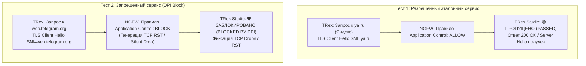

# Демонстрационный сценарий №2: Глубокий анализ пакетов (DPI) и выборочная блокировка приложений

> **Назначение:** Шаблон программы и методики демонстрации (ПМИ) для заказчика. Позволяет наглядно подтвердить точность и надежность работы модуля глубокого анализа пакетов (DPI / Application Control) на межсетевом экране следующего поколения (NGFW). Проверяется способность устройства распознавать протоколы и блокировать целевые веб-сервисы по сигнатурам TLS SNI и HTTP Host без разрыва легитимных сессий.  
> **Протоколы проверки:** HTTPS TLS 1.2 (расширение SNI, порт 443), HTTP/1.1 (заголовок Host, порт 80).  
> **Время проведения:** 15 минут.

---

## 🎯 1. Цели демонстрации
1. Доказать заказчику корректность распознавания прикладных сервисов (Telegram, VKontakte, YouTube, RuTracker) на L7-уровне.
2. Продемонстрировать разницу в обработке разрешённого эталонного трафика и заблокированного сервиса.
3. Показать корреляцию событий: фиксация сброса в веб-интерфейсе TRex Studio и появление запрещающей записи в журнале безопасности NGFW.

---

## 📋 2. Схема логики проведения теста

---

## 🛠️ 3. Пошаговые действия оператора

### Этап 1: Подготовка правил фильтрации на NGFW
1. Войдите в консоль управления тестируемого NGFW.
2. Перейдите в раздел **Контроль приложений (Application Control / DPI)**.
3. Создайте тестовое правило блокировки:
   * **Название правила:** `BLOCK_MESSENGERS_DEMO`
   * **Категория / Приложение:** `Telegram` (или домен `web.telegram.org`).
   * **Действие:** `Блокировать (Drop / Reset-Client)`.
   * **Логирование:** Включено (Log violations).
4. Убедитесь, что общее правило межсетевого экрана разрешает прочий интернет-трафик.

### Этап 2: Проверка разрешённого трафика (Эталонный тест)
1. Откройте веб-интерфейс TRex: `http://10.15.26.15:8080/`.
2. Перейдите на вкладку **«🕵️‍♂️ Проверка DPI / Приложений»**.
3. В поле «Домен» нажмите на чип **«Яндекс (Эталон)»** (`ya.ru`).
4. Выберите инкапсуляцию: `🔒 HTTPS TLS 1.2 (SNI 443)`.
5. Нажмите кнопку **«▶ Запустить проверку DPI»**.
6. Обратите внимание заказчика на:
   * На баннере вердикта загорается статус:  
     **`🟢 ПРОПУЩЕНО (PASSED)`**.
   * Скорость RX совпадает с TX, счётчик соединений возрастает, дропы отсутствуют.
7. Нажмите **«⏹ Остановить проверку DPI»**.

### Этап 3: Проверка блокировки запрещённого приложения
1. На вкладке **«🕵️‍♂️ Проверка DPI / Приложений»**:
   * Нажмите на чип **«Telegram»** (в поле подставится `web.telegram.org`).
   * Инкапсуляция: `🔒 HTTPS TLS 1.2 (SNI 443)`.
2. Нажмите кнопку **«▶ Запустить проверку DPI»**.
3. Через 2–4 секунды на экране загорится ярко-красный баннер вердикта:  
   **`🛡️ ЗАБЛОКИРОВАНО (BLOCKED BY DPI)`**.
4. Продемонстрируйте заказчику телеметрию в реальном времени:
   * Пакеты запросов отправляются клиентом (`TX > 0`).
   * Пакеты ответов не возвращаются (`RX = 0`).
   * Растёт счётчик **«Заблокировано NGFW (RST / Drop)»** и **«Таймауты / Retransmits»**.
5. Откройте журнал событий безопасности NGFW (Security Logs / Traffic Monitor):
   * Продемонстрируйте заказчику зарегистрированное событие:  
     *Source IP: `16.0.0.X`, Application: `Telegram`, Action: `Drop / Blocked by Rule BLOCK_MESSENGERS_DEMO`*.

### Этап 4: Проверка фильтрации по HTTP Host (Web-фильтр)
1. В поле домена выберите `vk.com` (ВКонтакте).
2. Смените протокол инкапсуляции на: `🌐 HTTP/1.1 (Host 80)`.
3. Запустите проверку и продемонстрируйте аналогичную блокировку на уровне заголовков открытого веб-трафика.

---

## 📊 4. Протокол фиксации результатов (Таблица демонстрации)

| №     | Проверяемый сервис / Домен | Протокол инкапсуляции | Политика NGFW | Вердикт TRex Studio | Зафиксировано в логах NGFW |
| ----- | -------------------------- | --------------------- | ------------- | ------------------- | -------------------------- |
| **1** | `ya.ru` (Яндекс)           | HTTPS (SNI 443)       | Разрешить     | `🟢 ПРОПУЩЕНО`      | [  ] Да (Разрешено)        |
| **2** | `web.telegram.org`         | HTTPS (SNI 443)       | Блокировать   | `🛡️ ЗАБЛОКИРОВАНО` | [  ] Да (Сброшено DPI)     |
| **3** | `vk.com` (ВКонтакте)       | HTTP (Host 80)        | Блокировать   | `🛡️ ЗАБЛОКИРОВАНО` | [  ] Да (Сброшено DPI)     |
| **4** | `rutracker.org` (Торренты) | HTTPS (SNI 443)       | Блокировать   | `🛡️ ЗАБЛОКИРОВАНО` | [  ] Да (Сброшено DPI)     |

**Представитель заказчика:** ____________________ / ____________________ /  
**Инженер испытательного стенда:** ____________________ / ____________________ /
