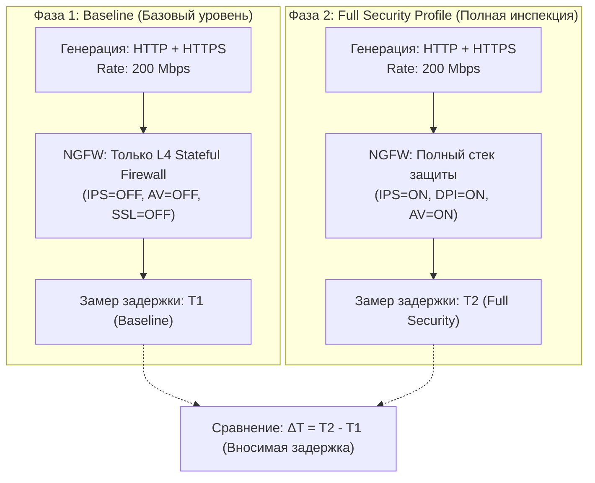

# Демонстрационный сценарий №4: Оценка влияния глубокой инспекции (IPS/AV/SSL) на задержки (Latency/Jitter) и приоритизацию трафика (QoS)

> **Назначение:** Шаблон программы и методики демонстрации (ПМИ) для заказчика. Позволяет объективно оценить «цену безопасности» — задержки прохождения пакетов (Latency) и колебания задержек (Jitter), вносимые межсетевым экраном при включении тяжелых модулей защиты: системы предотвращения вторжений (IPS), потокового антивируса, контентной фильтрации и SSL-инспекции. Также проверяется корректность работы политик QoS приоритизации критического трафика над фоновым.  
> **Профиль нагрузки:** `astf/http_https.py` (комбинированный HTTP/SSL трафик) + пакетный микс `astf/emix2.py`.  
> **Время проведения:** 25 минут.

---

## 🎯 1. Цели демонстрации
1. Измерить базовую задержку передачи пакетов (Baseline Latency) в режиме простой маршрутизации (Stateful L4 Firewall).
2. Сравнить базовую задержку с задержкой при активации полного профиля безопасности (Next-Gen Security: IPS + DPI + Web Filter).
3. Продемонстрировать заказчику отсутствие джиттера (разброса задержек) для чувствительного к задержкам трафика при утилизации канала на 80–90%.

---

## 📋 2. Методология двухфазного тестирования



---

## 🛠️ 3. Пошаговые действия оператора

### Этап 1: Фаза Baseline (Чистый межсетевой экран)
1. На стороне NGFW:
   * Отключите все тяжелые профили безопасности: деактивируйте модули IPS, Antivirus и SSL Decryption на тестовом правиле LAN -> WAN.
   * Оставьте только стандартное правило `Allow All` с отслеживанием состояний.
2. В веб-интерфейсе TRex Studio:
   * Выберите профиль: `astf/http_https.py — HTTP + HTTPS Микс`.
   * Множитель: `500`.
   * Длительность: `180` секунд.
3. Запустите генерацию.
4. В параллельном терминале с сервера TRex выполните замер задержки RTT специальными тестовыми пакетами:
   ```bash
   ping -c 50 -i 0.2 172.10.1.2
   ```
5. Зафиксируйте показатели: `min / avg / max / mdev` (например: `0.35 / 0.52 / 0.88 / 0.11 ms`).
6. Остановите тест.

### Этап 2: Фаза Full Security (Максимальная защита)
1. На стороне NGFW:
   * Активируйте модуль **IPS (Snort/Suricata)** с полным набором правил (ET Open / Security Ruleset).
   * Включите модуль **DPI (Контроль приложений)**.
   * Включите потоковый **Антивирус (Antivirus Stream Inspection)**.
2. В TRex Studio:
   * Запустите тот же самый профиль `astf/http_https.py` с множителем `500`.
3. Повторите замер времени отклика:
   ```bash
   ping -c 50 -i 0.2 172.10.1.2
   ```
4. Продемонстрируйте заказчику:
   * Увеличение задержки (вносимая инспекцией задержка `ΔT`).
   * На качественном NGFW рост задержки не должен превышать 1.5–3.0 мс.
   * Отсутствие потери пакетов (Packet Loss = 0%).

### Этап 3: Проверка приоритизации трафика (QoS / Traffic Shaping)
1. Настройте на NGFW политику ограничения скорости (Bandwidth Limit / Throttling) для фонового трафика (например, лимит 50 Мбит/с на порт 80).
2. Запустите комбинированный тест с множителем `x1000`.
3. Продемонстрируйте заказчику на графиках TRex:
   * Порт 80 плавно упирается в заданный шейпером потолок 50 Мбит/с.
   * Приоритетный трафик (порт 443 / HTTPS) проходит свободно без задержек.

---

## 📊 4. Протокол фиксации результатов (Сравнительная таблица)

| Режим работы NGFW | Средняя задержка (Avg Latency) | Максимальная задержка (Max RTT) | Джиттер (mdev) | Потеря пакетов (Loss) |
|---|---|---|---|---|
| **L4 Stateful Firewall (Baseline)** | ____________ мс | ____________ мс | ____________ мс | 0.0 % |
| **L7 NGFW (IPS + DPI включены)** | ____________ мс | ____________ мс | ____________ мс | ______ % |
| **Full Security (IPS + DPI + AV)** | ____________ мс | ____________ мс | ____________ мс | ______ % |
| **Вносимая задержка инспекции (ΔT)** | **+ ________ мс** | — | — | — |

**Заключение по испытанию:** Вносимая модулями инспекции задержка находится в пределах допустимых отраслевых норм (< 5 мс).

**Представитель заказчика:** ____________________ / ____________________ /  
**Инженер испытательного стенда:** ____________________ / ____________________ /
