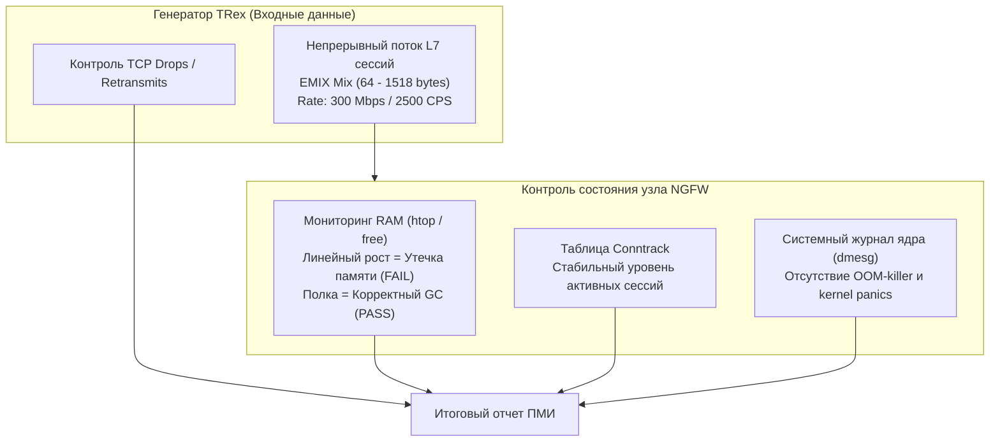

# Демонстрационный сценарий №5: Суточный стресс-тест на надежность и стабильность (Soak / Longevity Test)

> **Назначение:** Шаблон программы и методики демонстрации (ПМИ) для заказчика. Позволяет доказать долговременную аппаратную и программную надежность межсетевого экрана (NGFW) при непрерывной многочасовой нагрузке высокой интенсивности. Проверяется отсутствие утечек оперативной памяти (Memory Leaks), корректность сборки мусора и устаревания сессий в таблице `conntrack`, а также стабильность работы сетевых драйверов без зависаний ядра ОС.  
> **Профиль нагрузки:** `astf/emix2.py` (EMIX Пакетный микс пакетов разной длины)  
> **Время проведения:** от 30 минут (экспресс-демонстрация) до 24 часов (полный суточный приемо-сдаточный цикл).

---

## 🎯 1. Цели демонстрации
1. Доказать заказчику, что NGFW не теряет производительность при длительной непрерывной эксплуатации («эффект деградации со временем»).
2. Подтвердить отсутствие утечек памяти в процессах инспекции (Snort, Suricata, WAF, DNS-резолвер).
3. Проверить механизм автоматической очистки устаревших сессий (Connection Tracking Timeouts) при циклическом открытии и закрытии сотен тысяч соединений.

---

## 📋 2. Контролируемые параметры в процессе Soak-теста



---

## 🛠️ 3. Пошаговые действия оператора

### Этап 1: Фиксация начального состояния NGFW (T = 0)
1. Перед запуском генерации зафиксируйте базовые показатели на NGFW:
   ```bash
   # Объем свободной памяти
   free -m
   
   # Размер таблицы соединений
   cat /proc/sys/net/netfilter/nf_conntrack_count 2>/dev/null || conntrack -C
   
   # Проверка отсутствия ошибок ядра
   dmesg | tail -n 20
   ```
2. Занесите стартовые значения в протокол испытания.

### Этап 2: Запуск долговременного сценария в TRex Studio
1. Откройте панель TRex Studio (`http://10.15.26.15:8080/`).
2. Перейдите на вкладку **«📊 Дашборд & Нагрузка»**:
   * **Сценарий:** выберите `astf/emix2.py — EMIX Пакетный микс`.
   * **Множитель (-m):** задайте `1500` (1500 новых соединений в секунду, ~250–350 Мбит/с смешанного трафика).
   * **Длительность (-d):** задайте `3600` (для 1-часовой демонстрации) или `86400` (для суточного испытания).
3. Нажмите кнопку **«▶ Запустить генерацию»**.

### Этап 3: Промежуточный аудит (Контрольные точки каждые 15–30 минут)
В ходе демонстрации каждые 15 минут проверяйте следующие показатели:
1. **В окне TRex Studio:**
   * Пропускная способность (RX) должна идти ровной горизонтальной линией без спадов.
   * Количество **«Сбросов (Drops)»** должно оставаться равным 0.
   * Количество **«Ошибок интерфейсов L2 (NIC Errors)»** должно быть строго равно 0.
2. **В консоли NGFW:**
   * Уровень используемой оперативной памяти должен стабилизироваться на определённом уровне и не расти линейно вверх.
   * Таблица соединений `conntrack` должна колебаться в предсказуемом диапазоне (сессии закрываются так же быстро, как открываются новые).
   * В логе `dmesg` не должно появляться записей `nf_conntrack: table full, dropping packet` или `Out of memory: Kill process`.

### Этап 4: Завершение испытания и финальный срез (T = Конец теста)
1. Остановите генерацию трафика.
2. Подождите 60 секунд для естественного закрытия сессий по тайм-аутам (FIN-WAIT, TIME-WAIT).
3. Зафиксируйте конечное состояние памяти на NGFW:
   ```bash
   free -m
   conntrack -C
   ```
   *Память должна полностью вернуться к исходному значению (допускается дельта не более 3–5% на кэши).*
4. В TRex Studio нажмите **«📥 Скачать ПМИ (.md)»**.

---

## 📊 4. Протокол фиксации результатов (Паспорт долговременного теста)

| Параметр | Начало теста (T=0) | Середина теста (T=30 мин) | Окончание теста (T=60 мин) | Результат |
|---|---|---|---|---|
| **Используемая RAM (NGFW)** | ________ МБ | ________ МБ | ________ МБ | [  ] Утечек нет |
| **Число активных сессий (Conntrack)** | ________ | ________ | ________ | [  ] В норме |
| **Пропускная способность (RX)** | ________ Мбит/с | ________ Мбит/с | ________ Мбит/с | [  ] Без просадок |
| **Суммарный объем переданных данных** | 0 GB | ________ GB | ________ GB | — |
| **Ошибки ядра / Перезагрузки служб** | Нет | Нет | Нет | [  ] Сбоев нет |

**Итоговый вердикт:** Межсетевой экран выдержал долговременное стресс-испытание без деградации пропускной способности, утечек памяти и зависаний таблицы трансляций.

**Представитель заказчика:** ____________________ / ____________________ /  
**Инженер испытательного стенда:** ____________________ / ____________________ /
